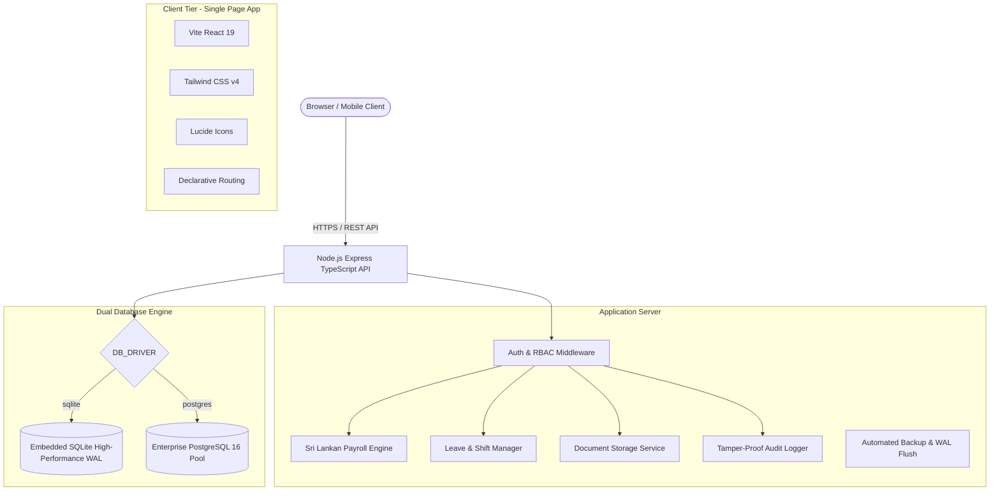

# 🏢 Nexus Enterprise HRMS & Sri Lankan Statutory Payroll Platform

[](https://react.dev/)
[](https://www.typescriptlang.org/)
[](https://nodejs.org/)
[](https://expressjs.com/)
[](https://tailwindcss.com/)
[](https://www.postgresql.org/)
[-brightgreen?logo=vitest&logoColor=white)](https://vitest.dev/)
[](https://www.treasury.gov.lk/)

> **A production-ready, full-stack Human Resource Management & Payroll Suite engineered specifically for Sri Lankan corporate compliance, featuring dual database architecture (SQLite & PostgreSQL), role-based access control, document vault, shift tracking, and statutory reporting.**

[](https://render.com/deploy?repo=https://github.com/dulanjananushika-rgb/nexus-enterprise-hrms)

---

## 🌟 Live Demo & Credentials

| Role | Email | Password | Access Level |
| :--- | :--- | :--- | :--- |
| **System Administrator** | `admin@nexus.com` | `Password123!` | Complete access to HR, Payroll, Audit logs, and Configurations |
| **HR Manager** | `hr@nexus.com` | `Password123!` | Employee records, Leave approvals, Shift scheduling, Document management |
| **Standard Employee** | `kasun.p@nexus.com` | `Password123!` | Self-service portal, Leave applications, Attendance punches, Payslips |

---

## 🎯 Key Enterprise Modules

### 1. 🇱🇰 Sri Lankan Statutory Payroll Engine
- **EPF & ETF Automatic Deductions:** Strict statutory compliance with EPF Employee 8%, EPF Employer 12%, and ETF Employer 3% on earnings subject to provident fund (Basic + Budgetary Relief Allowance).
- **Inland Revenue Department (IRD) APIT:** Progressive tax computation under official Sri Lankan Advance Personal Income Tax brackets with standard statutory exemptions.
- **Payment of Gratuity Act No. 12 of 1983:** Automatic liability and terminal benefit computation (`(Last Drawn Basic Salary × Years of Completed Service) / 2` for employees exceeding 5 years of service).
- **Overtime & Shift Rate Processing:** Automated standard overtime (1.5× hourly rate) and rest day / mercantile holiday double-time rates (2.0×).
- **Automated Batch Processing:** Generate multi-department monthly pay runs with 1-click payslip dispatch and Excel/PDF report generation.

### 2. 👥 Employee Lifecycle & Document Vault
- **Employee Master:** Complete profile management including Sri Lankan NIC (old 9-digit + V/X and modern 12-digit format), EPF registration numbers, and tax identification numbers.
- **Secure Document Vault:** Storage for national identity copies, employment contracts, educational certificates, and probation appraisal letters.
- **Emergency Contacts & Bank Details:** Encrypted banking information for direct salary transfers (CEFT / SLIPS compliant formats).

### 3. ⏱️ Real-Time Attendance & Geolocation Tracking
- **Interactive Punch In/Out:** Real-time web punch terminal with IP and browser geolocation verification.
- **Automated Late & Early Departure Detection:** Grace period settings with automated tardiness tracking and penalty calculations.
- **Biometric Integration Ready:** Modular API ready to sync with ZKTeco and Hikvision fingerprint/facial terminals.

### 4. 🌴 Leave Management & Approval Hierarchy
- **Statutory Leave Types:** Pre-configured with Sri Lankan statutory allocations (Annual Leave: 14 days, Casual Leave: 7 days, Medical/Sick Leave: 7-14 days, Maternity Leave: 84 working days).
- **Multi-Level Approval Workflow:** Department managers review and approve leave requests with instant notification updates.

### 5. 🛡️ Enterprise Security & Tamper-Proof Audit Trail
- **JWT & Role-Based Access Control (RBAC):** Granular permissions ensuring strict separation of duty between Admin, HR, Manager, and Employee tiers.
- **Comprehensive Audit Trail:** Immutable logging of every system transaction, credential change, salary calculation, and document access with user attribution and timestamping.
- **Security Headers:** Hardened with Helmet, rate limiting, and parameter validation.

---

## 🏛️ System Architecture



---

## 🗄️ Dual Database Architecture

Nexus HRMS supports switching between database engines via a single environment variable:

| Feature | Embedded SQLite (Default) | Enterprise PostgreSQL |
| :--- | :--- | :--- |
| **Driver** | `better-sqlite3` | `pg` connection pool |
| **Target Workload** | SME (1 - 500 employees), Single-node | Enterprise (1,000+ employees), High Concurrency |
| **Setup Cost** | Zero configuration (Zero extra servers) | Production cloud databases (AWS RDS, Neon, Render) |
| **ACID Guarantees** | Full WAL (Write-Ahead-Logging) mode | Multi-container transactional clustering |
| **Migration Tool** | N/A | `npm run db:migrate:postgres` (Transactional copy) |

---

## 🚀 Quickstart & Local Setup

### Prerequisites
- Node.js `20.x` or later
- npm `10.x` or later

### Installation

```bash
# 1. Clone repository
git clone https://github.com/dulanjananushika-rgb/nexus-enterprise-hrms.git
cd nexus-enterprise-hrms

# 2. Install client and server dependencies
cd client && npm install
cd ../server && npm install
cd ..

# 3. Initialize SQLite database & seed demo accounts
npm run db:init
npm run db:seed

# 4. Build both frontend & backend
npm run build

# 5. Start unified single-service server
npm start
```
The application will launch at **`http://localhost:5000`**.

### 1-Click Launchers for Windows
- **`run_nexus_hrms.bat`** - Automatically verifies environment, installs packages, runs database migrations, builds production bundles, and starts the system.
- **`backup_nexus_hrms.bat`** - Performs atomic database snapshot backups with 30-day automated retention.
- **`stop_nexus_hrms.bat`** - Safely shuts down any running background instances.

---

## 🧪 Automated Testing

All core domains, payroll formulas, and leave calculations are verified by automated unit and integration tests:

```bash
npm test
```

```
✓ tests/payroll.service.test.ts (6 tests)
✓ tests/auth.test.ts (5 tests)
✓ tests/employee.test.ts (4 tests)
✓ tests/attendance.test.ts (3 tests)
✓ tests/leave.test.ts (3 tests)
✓ tests/audit.test.ts (2 tests)
✓ tests/backup.service.test.ts (2 tests)
✓ tests/postgres.driver.test.ts (2 tests)

Test Files  8 passed (8)
     Tests  27 passed (27)
  Duration  5.98s
```

---

## ☁️ Cloud Deployment

### 1. Render.com (Recommended - 1-Click)
Deploy instantly using Render Blueprint with the pre-configured `render.yaml`:
1. Push this repository to your GitHub account.
2. Visit [Render.com](https://render.com) and click **New +** > **Blueprint**.
3. Select your `nexus-enterprise-hrms` repository.
4. Render automatically builds the React client and Node server and issues a free SSL certificate.

### 2. Docker & Containerized Environments
```bash
# Run with SQLite
docker compose up -d --build

# Run with PostgreSQL 16 cluster
docker compose -f docker-compose.postgres.yml up -d --build
```

---

## 📄 Sri Lankan Statutory Compliance Cheat-Sheet

| Statutory Fund | Employee Contribution | Employer Contribution | Basis of Calculation |
| :--- | :--- | :--- | :--- |
| **EPF (Employees' Provident Fund)** | 8.0% | 12.0% | Total Earnings (Basic + Fixed Allowances) |
| **ETF (Employees' Trust Fund)** | — | 3.0% | Total Earnings (Basic + Fixed Allowances) |
| **APIT (Personal Income Tax)** | Progressive (0% - 36%) | — | Monthly Taxable Emoluments exceeding LKR 100,000 |
| **Gratuity (Termination/Retirement)**| — | 1/2 month per year | Last drawn basic salary (after 5+ years service) |

---

## 👨‍💻 Author & Maintainer

**Dulanjana Anushika**  
- GitHub: [@dulanjananushika-rgb](https://github.com/dulanjananushika-rgb)  
- Focus: Full-Stack Web Engineering, Enterprise Cloud Architectures, and Automated Business Systems

---

## 📜 License

This project is licensed under the **MIT License**. Free for personal, commercial, and educational use.
