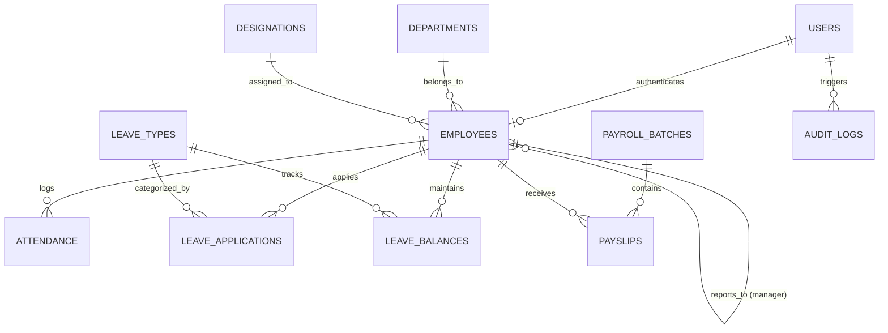

# DATA MODEL & SCHEMA SPECIFICATION: NEXUS HRMS

## 1. Relational Entity-Relationship Diagram

---

## 2. Table Specifications & Constraints

### 1. `users` (Authentication & Security)
| Column | Type | Constraints | Description |
|---|---|---|---|
| `id` | VARCHAR(36) | PRIMARY KEY | UUID v4 identifier |
| `email` | VARCHAR(255) | UNIQUE, NOT NULL | Login email (lowercase indexed) |
| `password_hash` | VARCHAR(255) | NOT NULL | bcrypt hash |
| `role` | VARCHAR(32) | NOT NULL | `SUPER_ADMIN`, `HR_MANAGER`, `LINE_MANAGER`, `EMPLOYEE` |
| `is_active` | BOOLEAN | DEFAULT 1 | Account active flag |
| `failed_login_attempts` | INTEGER | DEFAULT 0 | Counter for brute-force mitigation |
| `locked_until` | TIMESTAMP | NULL | Lockout expiration timestamp |
| `created_at` | TIMESTAMP | DEFAULT CURRENT_TIMESTAMP | Created timestamp |
| `updated_at` | TIMESTAMP | DEFAULT CURRENT_TIMESTAMP | Updated timestamp |

### 2. `departments` & `designations`
- `departments`: `id`, `name` (UNIQUE), `code` (UNIQUE), `description`, `created_at`.
- `designations`: `id`, `department_id` (FK), `title` (NOT NULL), `grade_level` (INT), `created_at`.

### 3. `employees` (Employee Master / PIM)
| Column | Type | Constraints | Description |
|---|---|---|---|
| `id` | VARCHAR(36) | PRIMARY KEY | UUID v4 |
| `user_id` | VARCHAR(36) | UNIQUE, FK(users.id) | Linked auth account |
| `employee_code` | VARCHAR(32) | UNIQUE, NOT NULL | Formal HR Code (e.g. `EMP-00101`) |
| `first_name` | VARCHAR(100) | NOT NULL | Given name |
| `last_name` | VARCHAR(100) | NOT NULL | Surname |
| `nic_passport` | VARCHAR(64) | UNIQUE, NOT NULL | National ID / Passport |
| `gender` | VARCHAR(16) | NOT NULL | `MALE`, `FEMALE`, `OTHER` |
| `date_of_birth` | DATE | NOT NULL | Age verification |
| `phone` | VARCHAR(32) | NOT NULL | Primary contact |
| `emergency_contact_name` | VARCHAR(128) | NOT NULL | Emergency contact name |
| `emergency_contact_phone` | VARCHAR(32) | NOT NULL | Emergency contact number |
| `department_id` | VARCHAR(36) | FK(departments.id) | Assigned department |
| `designation_id` | VARCHAR(36) | FK(designations.id) | Assigned designation |
| `manager_id` | VARCHAR(36) | FK(employees.id), NULL | Direct reporting manager |
| `employment_status` | VARCHAR(32) | NOT NULL | `ACTIVE`, `PROBATION`, `SUSPENDED`, `TERMINATED` |
| `hire_date` | DATE | NOT NULL | Date commenced work |
| `base_salary_cents` | INTEGER | NOT NULL | Base monthly salary in cents (integer precision) |
| `bank_name` | VARCHAR(128) | NOT NULL | Bank for payroll |
| `bank_account_number` | VARCHAR(64) | NOT NULL | Account number |
| `bank_branch_code` | VARCHAR(32) | NOT NULL | Branch routing code |
| `created_at` | TIMESTAMP | DEFAULT CURRENT_TIMESTAMP | Audit timestamp |

### 4. `attendance` (Time & Attendance)
| Column | Type | Constraints | Description |
|---|---|---|---|
| `id` | VARCHAR(36) | PRIMARY KEY | UUID v4 |
| `employee_id` | VARCHAR(36) | FK(employees.id), NOT NULL | Employee |
| `date` | DATE | NOT NULL | Working day (YYYY-MM-DD) |
| `clock_in_time` | TIMESTAMP | NOT NULL | Arrival timestamp |
| `clock_out_time` | TIMESTAMP | NULL | Departure timestamp |
| `status` | VARCHAR(32) | NOT NULL | `PRESENT`, `LATE`, `HALF_DAY`, `ON_LEAVE`, `ABSENT` |
| `work_mode` | VARCHAR(16) | DEFAULT 'ON_SITE' | `ON_SITE`, `REMOTE` |
| `ip_address` | VARCHAR(45) | NULL | IPv4/IPv6 client address |
| `total_worked_minutes`| INTEGER | DEFAULT 0 | Calculated duration |
| `ot_minutes` | INTEGER | DEFAULT 0 | Approved overtime minutes |
| UNIQUE(employee_id, date) | | UNIQUE INDEX | Enforces single primary log per day |

### 5. `leave_types` & `leave_balances` & `leave_applications`
- **`leave_types`**: `id`, `code` (`ANNUAL`, `CASUAL`, `MEDICAL`, `MATERNITY`, `UNPAID`), `name`, `annual_entitlement` (Days, e.g. 14, 7).
- **`leave_balances`**: `id`, `employee_id`, `leave_type_id`, `year`, `entitled_days`, `used_days`, `pending_days`, `remaining_days`.
- **`leave_applications`**:
  - `id`, `employee_id`, `leave_type_id`, `start_date`, `end_date`, `total_days`, `reason`, `status` (`PENDING`, `APPROVED_MANAGER`, `APPROVED_HR`, `REJECTED`, `CANCELLED`), `reviewed_by_user_id`, `rejection_reason`, `created_at`.

### 6. `payroll_batches` & `payslips`
- **`payroll_batches`**: `id`, `month` (e.g. `2026-11`), `status` (`DRAFT`, `REVIEWED`, `PAID`, `CANCELLED`), `total_gross_cents`, `total_net_cents`, `total_epf_cents`, `created_by`, `paid_at`.
- **`payslips`**:
  - `id`, `batch_id` (FK), `employee_id` (FK), `base_salary_cents` (INT), `allowances_cents` (INT), `overtime_pay_cents` (INT), `unpaid_leave_deductions_cents` (INT), `gross_salary_cents` (INT),
  - `employee_epf_cents` (INT, 8%), `employer_epf_cents` (INT, 12%), `employer_etf_cents` (INT, 3%),
  - `apit_tax_cents` (INT), `other_deductions_cents` (INT),
  - `net_salary_cents` (INT),
  - `status` (`GENERATED`, `SENT`, `PAID`), `created_at`.

### 7. `audit_logs` (Append-Only)
| Column | Type | Constraints | Description |
|---|---|---|---|
| `id` | VARCHAR(36) | PRIMARY KEY | UUID v4 |
| `user_id` | VARCHAR(36) | NULL | Actor (or NULL for system) |
| `action` | VARCHAR(64) | NOT NULL | `LOGIN`, `SALARY_UPDATE`, `LEAVE_APPROVAL`, etc. |
| `entity_type` | VARCHAR(64) | NOT NULL | `EMPLOYEE`, `PAYROLL`, `LEAVE` |
| `entity_id` | VARCHAR(64) | NOT NULL | Target record ID |
| `old_value_json` | TEXT | NULL | Snapshot before mutation |
| `new_value_json` | TEXT | NULL | Snapshot after mutation |
| `ip_address` | VARCHAR(45) | NULL | Request IP |
| `created_at` | TIMESTAMP | DEFAULT CURRENT_TIMESTAMP | Immutable creation time |
